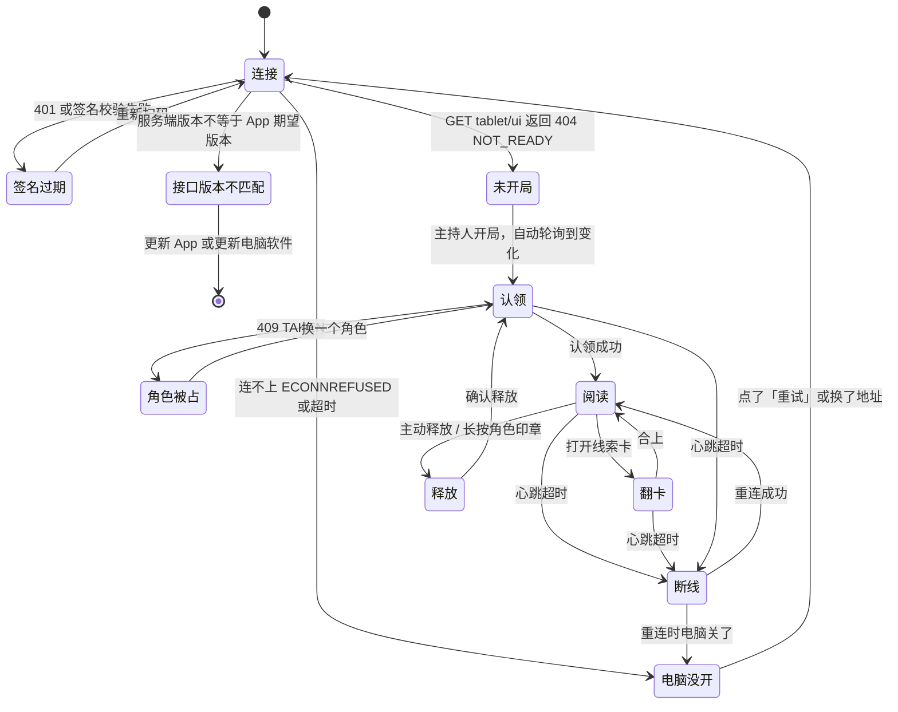

# 平板原生 App（Flutter）界面与交互设计

> **2026-10-25 晚：§5 的三个视觉方向全部作废**，用户原话「看起来像网页 而不是平板app；风格作废」。现行设计是 Flutter 可点原型，见 `2026-10-25-tablet-flutter-prototype.md`。本文件的场景表、状态图、流畅度指标和验收方法仍可参考。

日期 2026-10-25。状态：**设计稿，待选方向**。按 ADR 0012（`docs/decisions/0012-tablet-native-flutter-app.md`）做界面与交互设计，**本轮不写正式代码**。选定方向后再更新 ADR。

范围：只做平板 App 端。**本轮不动网页端**（是否长期保留见 ADR 0012 待确认问题 2），App 是新增的第二个客户端。

本文件不含剧本正文、卡面文字或真相。所有示意文字自编或来自合成探针。

---

## 1. 需要你提供的原始材料

| 材料 | 状态 | 本轮怎么办 |
|---|---|---|
| 平板型号与屏幕参数 | **你不提供** | 按「较新的通用版本」定档：iPad Air 11″（2024，1194×834 逻辑像素）与主流安卓平板（1280×800）。真机验收时再换成实际型号 |
| 原稿扫描页统计数字（页数、分辨率、单页体积） | 你说可以从项目文件夹看 | 取自仓库文档 `docs/evidence/tablet/card-structure-probe.md`（只含数字与结构，不含剧情）。**没有读 `stories/`** |
| 真实剧本跑一遍 | 你说用「加个v呗」这本，**我没听准** | 本轮用合成探针跑通全接口（真实 JSON + 真实图片字节）。剧本名待你确认后再跑真包 |
| 暗光环境的实际亮度、桌面照明 | 无 | 按剧本杀常见暗包间设计，暗光模式做成三档可调 |

**本轮没有读 `stories/`、`.appdata/`、`.local/`。** 素材全部来自合成探针与仓库文档。

---

## 2. 实测依据（不是设想）

### 2.1 合成探针跑通的接口

本机起 `src/LocalDm.Tablet` 合成模式（`ASPNETCORE_ENVIRONMENT=Development dotnet run --no-build -- --urls http://127.0.0.1:5099`），实测返回：

```
POST /tablet/claim?roleId=role-3  → {"claimed":true,"roleId":"role-3"}
POST /tablet/claim?roleId=role-1  → 409 {"claimed":false,"reason":"TAKEN"}
GET  /tablet/catalog               → {"storyTitle":"雨停之前","roles":[6],"cards":[6],"claimedRoles":[]}
GET  /tablet/role/book             → {"roleId","storyTitle","chapters[].blocks[].kind|text|sourcePageNumber|imageAssetId|imageCaption","confidence"}
GET  /tablet/role/progress         → {"roleId","characterOffset","settings{fontSize,lineSpacing,focusMode,preferText,sourcePageNumber,columns}"}
GET  /tablet/public?after=0        → {"sessionId","phase{id,title}","messages[]{sequence,messageId,author,kind,text,createdAt}","nextSequence","host{busy,speaking}"}
GET  /tablet/ui?after=0            → {"sessionId","title","state","revision","phaseId","phaseTitle","phaseIndex","phaseCount","hint","phases[]","controls[]","pendingMaterialCount","releasedMaterialCount"}
GET  /tablet/cards/card-1/front    → 200 image/png
GET  /tablet/cards/card-1/back     → 404（无卡背）
GET  /tablet/cards/nope/front      → 404
GET  /tablet/role/source/9         → 404（页码越界）
POST /tablet/release               → {"released":true}
```

取到的真实图片字节（已内嵌进设计稿）：卡面 300×200、原稿页 400×600、手册页 400×600。

### 2.2 原稿扫描页的真实规格

| 项 | 《孽岛疑云》（5人） | 《K7-星火号》（5人） |
|---|---|---|
| 线索卡 | 54 张（正 54 / 背 54），单张 **996×648** | 55 张，来自 6 张 **A4 整版 2550×3507** |
| 角色本 | 单页 JPG，每人约 **12 页** | 多页 PDF，每人 **18 页**，原文件 11–12 MB/本 |
| 原稿图 | 约 **1754×2480**，**700 KB–1.3 MB/页** | 预渲染 **150 DPI → 821×1259（约 310 KB/页）**；200 DPI → 1095×1678（约 506 KB/页） |
| 离线渲染 | — | 约 **0.32 秒/页** |

来源：`docs/evidence/tablet/card-structure-probe.md`。

**性能基线按 821×1259 / 1095×1678 算，不按合成探针的小图算** —— 合成图只验证了接口链路。

### 2.3 屏幕参数

| 设备 | 物理 | 逻辑（设计基准） |
|---|---|---|
| iPad Air 11″（2024） | 2388×1668 @2x | **1194×834** 横 / 834×1194 竖 |
| iPad Pro 11″（M4） | 2420×1668 @2x | 1210×834 |
| 安卓平板（2024 主流） | 2560×1600 @2x | **1280×800** 横 / 800×1280 竖 |

Flutter 用 dp/sp，与现有网页的 px 一一对应（正文 19px = 19sp）。

### 2.4 工具链落位（缓存不进 C 盘）

| 东西 | 落在哪 | 说明 |
|---|---|---|
| Flutter SDK / Android SDK / JDK | `D:\2\dev\dm\.tools\` | 已加进 `.gitignore`（`/.tools/`） |
| `PUB_CACHE` | `D:\2\dev\dm\.tools\pub-cache` | 默认在 `%LOCALAPPDATA%`，必须改 |
| `GRADLE_USER_HOME` | `D:\2\dev\dm\.tools\gradle` | 默认在 `%USERPROFILE%\.gradle` |
| `ANDROID_HOME` / `ANDROID_USER_HOME` | `D:\2\dev\dm\.tools\android-sdk` / `...\android-home` | 默认在 `%LOCALAPPDATA%\Android` |
| `PLAYWRIGHT_BROWSERS_PATH` | `D:\2\dev\dm\.tools\playwright-browsers` | 本轮装 chromium 时已经按这个落位 |

由 `scripts/setup-tablet-toolchain.ps1`（待写）统一设好并写进 `apps/tablet/.env` / 开发者文档。

---

## 3. 场景表：五个游戏阶段

每一阶段四栏：**玩家在干什么 / 平板首屏显示什么 / 哪些网页功能不搬 / 哪些手势要换**。

### 3.1 读本（开场后 30–60 分钟）

| 项 | 内容 |
|---|---|
| 玩家在干什么 | 低头读自己的角色本；偶尔翻回前一章找一句话；把卡面记个大概 |
| 平板首屏 | **角色本阅读器**：满屏一页原稿扫描页（或文字重排版），页脚「第 N 页 / 共 12 页 · 第 X 章」，右上角角色印章 |
| 不搬的网页功能 | ① 顶部页签（改成左栏 / 底部抽屉）；② 发言条与 `/tablet/say`、`/tablet/say/stop`（ADR 0012 决定 4）；③ 桌面滚轮缩放；④ 浏览器「后退」按钮 |
| 手势要换 | 网页「长按 0.65 秒圆环走满才翻开」→ **页面左右边缘轻扫翻页 + 页码常驻 + 1 秒内可反向翻回**。原生响应 60–120ms，长按延迟在平板上只会误触；防误看改由「页码可见 + 误翻可退」承担 |
| | 网页「点两下放大」→ **取消**（会和翻页打架）。放大只留双指捏合（1×–5×）与双击复位 |
| | 网页单指拖动平移 → 保留（放大后），但与翻页手势按「缩放状态」切换：s > 1.01 时拖动是平移，否则是翻页（沿用网页 `photo-viewer.js` 的判定逻辑） |

### 3.2 搜证（发牌之后，讨论之前）

| 项 | 内容 |
|---|---|
| 玩家在干什么 | 翻自己的线索卡；把卡背的文字记下来；偶尔看一眼公开对话确认现在是第几环节 |
| 平板首屏 | **线索卡目录**：分组列出的卡名（题签 / 方块两种排法，见第 5 节方向）；不可用的卡标「这一组暂停分发」而不是藏起来；右上角常驻「当前环节：搜证」 |
| 不搬的网页功能 | ① 发言（同上）；② 网页的「公开对话」独立页签（搜证阶段改为同屏可见或角标提示，不再单独占一个页签） |
| 手势要换 | 网页「长按翻面」→ **单击卡面 3D 翻转（正面 ↔ 背面）**，再点翻回。翻面是高频动作，长按留给「按住遮住」（防偷看）。无卡背时点开直接说清原因，不给空白 |

### 3.3 讨论

| 项 | 内容 |
|---|---|
| 玩家在干什么 | 抬头看人、听别人说；偶尔低头看一眼自己的卡或本子；等主持推进环节 |
| 平板首屏 | **保持当前视图 + 顶部环节条**（第 2 环节 / 共 5）。不强制切页——讨论时玩家频繁低头，强切页会打断 |
| 不搬的网页功能 | ① 发言（**这是这一阶段最大的变化**：网页版玩家能在平板上打字接话，App 删掉后讨论全靠嘴，需要在验收里确认这不难受） |
| 手势要换 | 无新增手势。唯一要求：**返回键不能误触**——讨论中玩家频繁滑动，返回手势（从屏幕边缘滑）会和「平移/翻页」冲突。建议返回改用左下角固定按钮 + 系统返回只退到上一页 |

### 3.4 投票

| 项 | 内容 |
|---|---|
| 玩家在干什么 | 确认自己的票、听别人的票；投票环节要求每轮都有记录（`Session.VoteSummaryPhaseId` + `VoteHistory`） |
| 平板首屏 | **公开对话 + 环节条**，显示当前是投票环节；玩家自己的票在**电脑端**投（现状：平板没有投票录入接口） |
| 不搬的网页功能 | 网页的投票录入区本来就不在平板上，没有可搬的 |
| 手势要换 | 无 |

> 投票环节暴露一个缺口：ADR 0012 的接口清单里没有「平板提交投票」。本轮设计**不新增投票入口**，投票仍在电脑端。若要平板投票，是接口范围变更，要单独立项。

### 3.5 揭秘

| 项 | 内容 |
|---|---|
| 玩家在干什么 | 听真相、看公开真相文本 |
| 平板首屏 | **公开对话流**，主持的真相消息按 `kind` 单独起一段（`/tablet/ui` 的 `revealedTexts`） |
| 不搬的网页功能 | 网页没有独立「揭秘」页，无可搬的 |
| 手势要换 | 无 |

---

## 4. 状态图



### 4.1 每个状态的页面与文案

| # | 状态 | 页面 | 标题文案 | 说明文案 | 操作 | 依据 |
|---|---|---|---|---|---|---|
| 1 | **连接** | 连接页（二维码框 + 地址输入框 + 状态行） | 连上你的电脑 | 扫电脑上的二维码，或手动输入地址。地址会记在这台平板上，下次直接连。 | 输入框 / 「连接」按钮 / 状态行「正在连接 192.168.1.23…」 | — |
| 2 | **认领** | 选角色页（角色印章卡格） | 选择一个角色 | 已经被别人认领的角色不能再选。随时可以释放角色换人。 | 点角色印章认领 | `GET /tablet/catalog` → `roles[]` + `claimedRoles[]` |
| 3 | **阅读** | 角色本阅读器（满屏一页原稿 / 文字重排） | 剧本名 + 章节名（书眉） | 页脚「第 N 页 / 共 12 页 · 第 X 章」 | 翻页 / 捏合缩放 / 工具条 | `GET /tablet/role/book`、`/tablet/role/source/{n}` |
| 4 | **翻卡** | 线索卡查看器（全屏卡面 + 翻转） | 线索卡 · 书房 | 角标「地点 · 第 1 张」；背面不可用时说「这一组暂停分发，换一张卡看看」 | 单击翻面 / 长按遮住 / 合上 | `GET /tablet/cards/{id}/front|back` |
| 5 | **释放** | 确认对话框（覆盖在当前页上） | 释放这个角色？ | 释放后，这个角色可以给别人认领。你自己的阅读进度会清掉。 | 「释放」/「取消」 | `POST /tablet/release` |
| 6 | **断线** | 半屏横幅（不遮正文） | 和电脑断开了，正在重连… | 横幅右侧「重连」；页脚显示「离线：已缓存的这一页还能看」 | 「重连」按钮；自动退避重试 1s/2s/5s/10s/30s | — |
| 7 | **电脑没开** | 全屏错误页 | 连不上电脑 | 确认电脑上的软件已经打开，平板和电脑在同一个 Wi-Fi。 | 「重新连接」/「换个地址」 | TCP 连不上 |
| 8 | **角色被占** | 选角色页（该角色印章置灰）+ 轻提示 | 这个角色刚被别人选走了 | 换一个角色吧。 | 自动回到选角色页 | 409 `{"claimed":false,"reason":"TAKEN"}` |
| 9 | **未开局** | 等待页（呼吸圈） | 等待主持人开始这一局 | 电脑打开剧本后，这里会自动变成选角色页，不用刷新。 | 无（自动轮询 `/tablet/ui`） | 404 `{"ok":false,"code":"NOT_READY"}` |
| 10 | **签名过期** | 全屏页 | 这次连接过期了 | 请回到电脑，重新扫一次二维码。 | 「重新扫码」 | 配对令牌过期（见 §6.3） |
| 11 | **接口版本不匹配** | 全屏页 | 电脑上的软件和这个 App 对不上 | 请在电脑上更新软件，或者让朋友发一个新版 App。 | 「重新检查」/「查看版本」 | `X-LocalDm-Version` 不匹配 |

**文案规矩**：接口返回的 HTTP 码和 `reason` 字符串一律不直接显示。每个失败都要翻译成上面这样一句人话，并给出下一步动作。「这一组暂停分发」和「没有这张卡」必须分开说 —— 前者是 409（换一张），后者是 404（没有）。

---

## 5. 视觉方向（三个，待你选）

用 huashu-design 技能做的三方向门。共同输入 `docs/preview/tablet-app-20261025/spec.md`，方向卡 `.../directions.md`，初稿 `.../design-demos/dir-{1,2,3}.html`，缩略图 `.../design-demos/thumbs.html`。

沿用 2026-10-23 网页版选定的**书卷**风格（用户原话「选方向一『书卷』」），三个方向都在书卷语境里，差异落在**骨架**上。

| | 方向一 书卷·单页 | 方向二 书卷·案卷 | 方向三 书卷·墨夜 |
|---|---|---|---|
| 来源 | 吕敬人（书籍装帧思维：版心呼吸、切口旁注栏） | 靳埭强 / 韩家英（汉字当结构材料）+ 民国书衣题签条 | Kindle Paperwhite 前灯 + Apple Books 暗色 |
| 骨架 | 沉浸单页 + 右侧 76px 旁注栏 | 横屏三栏案卷（目录 / 内容 / 公开对话） | 竖屏单页 + 底部章节抽屉 |
| 气质 | 安静、密度低 | 主动、密度高 | 安静、暗色 |
| 强项 | 读原稿最沉浸；旁注栏窄到别人读不了 | 搜证时卡与对话同屏，不来回切 | 暗光与防偷看做到极致（一键熄屏、前灯色温） |
| 代价 | 竖屏旁注栏放不下；搜证要来回翻 | 三栏把原稿压到 ~650px 宽，字会小；竖屏要改抽屉 | 暗色与「白纸」意象背离；横屏要重做 |
| 板面构图 | 主屏放大居中 + 下方横排两台竖屏 | **摊开成三页**：同一屏的左中右三栏并排裁切 | **左主右辅**：竖屏主屏在左，横屏退让版与说明在右 |
| 截图 | `shots/dir-1.png` | `shots/dir-2.png` | `shots/dir-3.png` |

三版板面底色也刻意分开：方向一深胡桃 `#241D16`、方向二深墨绿 `#16211C`、方向三近黑 `#0A0908`（暗处围桌的桌面感）。

**三个备选**（备选卡在 `directions.md`）：书卷·阅读（Matter 式纯文字目录）、书卷·仪（Halide 式刻度尺）、书卷·拆（汉字笔画导航）。

### 5.1 体检结果

`design_lint.py check` 对四个文件（三个完整版 + 缩略图页）**全部通过：没有红灯，没有模板装饰**。

体检过程中被改掉的真问题（不是绕过检测）：

| 问题 | 处置 |
|---|---|
| App 内 9px / 10px / 11px 小字（标签下限 12px） | 全部提到 12px；正文提到 14px。平板上 11sp 确实偏小，真机验收时按 12sp 起步 |
| `--muted #716D63` 放在纸深底上只有 4.41:1（不达标） | App 端 muted 改 `#6C685E`（纸深底 4.75:1） |
| 不可用题签用 `opacity:.45` 压暗，文字对比度掉到 2.67 | 改成虚线边框 + muted 文字色 + 朱砂「暂停」标记，文字保持 5:1 以上 |
| 翻页遮罩里的文字体检判为 1:1 | 去掉那段装饰文字（本来就是 180ms 的瞬时状态），遮罩改成纯纸面 |
| 三版板面构图雷同（compare 报骨架相关 0.75–0.88） | 方向二改成「摊开三页」、方向三改成「左主右辅」，骨架相关降到 0.03–0.41 |

留下的黄灯：缩略图页里 Halide 候选的等宽小字标签（那是该候选本身的气质），以及「1px 细线 + 零圆角」的外观家族提示 —— 后者正是你选定的「书卷」风格的一部分，不改。

选定后：把选择原话写进 `docs/preview/tablet-app-20261025/direction-approved.md`，出高保真稿（把选定方向的每一屏做成可交付规格：精确尺寸、字号、间距、色值、状态、动效时长），再更新 ADR 0012。

---

## 6. 防偷看与暗光阅读

这两件事是选 Flutter 的主要理由之一（网页做不到），所以单独列。

### 6.1 防偷看

| 层 | 做法 | 平台 | 备注 |
|---|---|---|---|
| 内容层 | 旁注栏 / 题签条做得窄（76px / 22px），别人扫一眼读不全 | 双端 | 界面层的真本事 |
| 覆盖层 | **遮罩**：一键把当前内容换成中性页（纸面 + 角色印章 + 「已遮罩」），不留半屏残影 | 双端 | 比「最小化」可靠：最小化会露出任务栏预览 |
| 熄屏 | **一键熄屏**：屏幕全黑、App 继续跑，再点恢复 | 双端 | 围桌时最实用的一个按钮 |
| 截图 | 安卓 `FLAG_SECURE` 禁止截图与录屏、禁止投屏 | 安卓 | iOS 无公开 API 阻止截图 |
| 录屏/投屏检测 | iOS 26 有 `UIScreen.isCaptured`，检测到即遮罩；安卓用 `MediaProjection` 检测权限 | 双端 | 只在系统给权限时可靠 |
| 通知 | 不申请通知权限；App 内不显示任何可预览的通知内容 | 双端 | 锁屏预览是常见泄露点 |
| 任务切换 | 切后台时立即覆盖一层遮罩，回前台先要求一次点击 | 双端 | 安卓 recents 缩略图会截屏 |

**必须说清的边界**：现状接口把**全部卡与全本页面**一次发给平板（`docs/project-state.md` 已记录「页面没按环节解锁，全本都发到平板」）。App 端再好的遮罩也改变不了这一点 —— 真正的分环节解锁是接口范围变更，不在本次设计范围。界面防偷看解决的是「邻座看到」，不是「拿到设备就能看」。

### 6.2 暗光阅读

| 档 | 做法 | 效果 |
|---|---|---|
| 原色 | 扫描页原样 | 白天 |
| 压暗 | 叠一层 42% 的暖黑罩（`rgba(26,19,12,.42)`），**不改原图** | 灯暗时主力档；浅底纹、淡墨线都还在 |
| 反色 | 白色文字 + 深底（`difference` 混合） | 几乎全黑的环境 |

另有**前灯滑杆**：调亮度与色温（2400K–5200K），一键把页面调到最暗而不熄屏。

理由来自现实参照：Kindle Paperwhite 的前灯就是为暗处读纸页做的 —— 屏幕里放一盏「灯」，而不是把纸调成黑的。

### 6.3 配对令牌（签名过期状态的前提）

现状接口靠浏览器 Cookie 认会话（`TabletSessions.cs`，`MaxAge` 1 天），隔天就掉。ADR 0012 决定改用 App 自带设备编号 `X-LocalDm-Device`。本设计再加一层：

- 电脑启动时生成**配对令牌**（HMAC 签名 + 有效期），二维码 URL 里带 `?pair=<token>`；
- App 首次扫码时取回令牌，之后每个请求带 `X-LocalDm-Pair`；
- 令牌过期 / 本局结束 / 换剧本 → 签名过期 → 让玩家重新扫一次；
- **签名过期只清连接，不清角色**：玩家重新扫码后认领的角色应该还在（认领状态存在电脑端）。

签名算法与有效期属实施计划，不在本次设计范围。

---

## 7. 流畅度指标

### 7.1 指标与门限

基准设备：**最旧平板 = iPad Air 11″（2020，A14）**；安卓侧以 2021 年千元档平板为下限。

| 指标 | 目标 | 门限（不达标即不过） | 测量口径 |
|---|---|---|---|
| **原稿翻页出图耗时（冷）** | P95 ≤ 700 ms | **P95 ≤ 900 ms，最差 ≤ 1500 ms** | 从手指抬起 → 新页完整可见。局域网取 310 KB/页（821×1259 JPEG） |
| **原稿翻页出图耗时（热）** | P95 ≤ 60 ms | **P95 ≤ 80 ms** | 页面已在内存缓存（当前页 ±2） |
| **原稿翻页出图耗时（邻页预取命中）** | P95 ≤ 120 ms | **P95 ≤ 150 ms** | 预取已下载未解码 |
| **翻页手势响应** | ≤ 16 ms | **≤ 33 ms**（两帧内） | 手指抬起 → 页面开始动的第一帧 |
| **滚动帧率（文字重排）** | 稳定 60 fps | **Jank 帧占比 ≤ 1%**；`totalRasterization` p95 ≤ 16.67 ms | 连续滚动 10 秒 |
| **滚动帧率（图片网格）** | 稳定 60 fps | 同上 | 54 张卡列表来回滚 3 趟 |
| **滚动帧率（ProMotion 120Hz）** | 120 fps | **p95 帧时间 ≤ 8.3 ms** | iPad Pro 机型额外测 |
| **双指缩放** | ≥ 50 fps | **全程不低于 30 fps** | 1×↔5× 连续缩放 5 次 |
| **冷启动到可交互** | ≤ 1.8 s | **≤ 2.5 s** | 杀掉进程 → 冷启 → 能翻页 |
| **常驻内存** | ≤ 140 MB | **≤ 180 MB** | 不缓存全本图片，只留当前页 ±2 |
| **峰值内存** | ≤ 260 MB | **≤ 320 MB** | 连续翻完整本 12 页时 |
| **断线重连** | ≤ 1.5 s | **≤ 3 s** | 恢复网络到页面可用 |

「Jank 帧」用 Android `FrameMetrics` 的定义：单帧耗时 > 16.67 ms × 1.5。

### 7.2 怎么用 Flutter DevTools 测

**前提**：`flutter run --profile`。Debug 模式下 jank 率天然高，数字没有意义；Release 模式没有时间线数据。

```bash
# 安卓真机
flutter run --profile -d <device-id>
# iPad 真机（需 flutter run 到真机，签名用免费 Apple ID）
flutter run --profile -d <ios-uuid>
```

**A. 翻页出图耗时（冷 / 热 / 预取）**

在图片组件上量，不靠肉眼看。给原稿页加一个测量用的 `Image` 包装：

```dart
// 冷：从网络取到并解码完成
final sw = Stopwatch()..start();
await precacheImage(provider, context);
sw.stop();
debugPrint('sourcePage cold=${sw.elapsedMilliseconds}ms');

// 热：命中 ImageCache
final key = provider is ResizeImage ? provider : ResizeImage(provider, const Size(1095, 1678));
final t0 = DateTime.now();
await precacheImage(key, context);
debugPrint('sourcePage warm=${DateTime.now().difference(t0).inMilliseconds}ms');
```

更准的做法是量「手指抬起 → 新页第一帧完整可见」：在新页的 `Image` 上挂

```dart
Image(image: img, frameBuilder: (ctx, child, frame, wasSyncLoaded) {
  if (frame != null) sw.stop();
  return child;
})
```

`frameBuilder` 拿到 `frame != null` 的那一刻，就是这张图已经画完的时刻。

**B. 滚动帧率**

1. DevTools → **Performance** 面板 → 勾 **Track frame rendering**；
2. 在真机上连续滚动 10 秒（文字重排）和来回滚 3 趟（卡片网格）；
3. 看 **Flutter Frames** 图表：
   - 绿条 = 60 fps 达成；
   - 红条 = jank，点开红条能看到是 **UI thread** 超时还是 **Raster thread** 超时。
4. 关键判读：
   - **Raster 超 16.67 ms** → GPU 忙，通常是图片解码 / 纹理上传 → 检查是不是每次翻页都在解码大图、`cacheWidth` 有没有给；
   - **UI 超 16.67 ms** → 主线程忙，通常是列表 item 每次 rebuild → 检查 `const`、缓存 item、把 `Image` 换成 `Image.asset`/`Image.memory` 复用。

要拿原始数据，用代码收集后导出：

```dart
import 'dart:developer' as developer;

final timings = <FrameTiming>[];
void listen() {
  SchedulerBinding.instance.addTimingsCallback((list) => timings.addAll(list));
}

void report() {
  final raster = timings.map((t) => t.rasterDuration.inMicroseconds).toList()..sort();
  final build  = timings.map((t) => t.buildDuration.inMicroseconds).toList()..sort();
  final total  = timings.map((t) => t.totalSpan.inMicroseconds).toList()..sort();
  double p(List<int> v, double q) => v.isEmpty ? 0 : v[(v.length*q).floor().clamp(0, v.length-1)] / 1000;
  developer.log('raster p95=${p(raster,.95)}ms build p95=${p(build,.95)}ms total p95=${p(total,.95)}ms frames=${timings.length}');
}
```

**C. 缩放与动画**

缩放用 `InteractiveViewer`，在它上面同时看 Performance 的 Raster/UI 两条线；只要掉到 30fps 以下，说明缩放时在实时解码 —— 改成缩放用已解码的 `ui.Image`（`RawImage`），不要用会重新解码的路径。

**D. 内存**

- DevTools → **Memory** 面板：看 Image cache 命中与大小；
- 安卓：`adb shell dumpsys meminfo <包名>`；
- iOS：Xcode Instruments → Allocations。

**E. 网络**

DevTools → **Network** 面板能看到图片请求（局域网 HTTP）。重点看两件事：TTFB 和单页字节数。若服务端不支持 `Cache-Control`，图片每翻一次都要重新下载 —— 这是必须先解决的服务端问题，不是 App 问题。

**F. 别踩的坑**

- 不要用 Chrome 里跑 Flutter Web 版测这些数字；
- 不要在 Debug 模式测；
- Simulator/模拟器的 GPU 与真机差很多，帧率必须在真机测；
- `--profile` 与 `--release` 的数字接近，但 `--release` 无法开时间线，最终验收要在 `--profile` 下量、用 `--release` 验一遍观感。

---

## 8. 验收方法

### 8.1 朋友在真平板上不经提示完成任务

**做法**：给一位没参与设计的朋友一台**真平板**（iPad 或安卓），App 连一台跑着合成剧本的电脑。**不解释界面**，只说一句任务目标。任务完成或卡住为止，全程录像 + 计时。

| # | 任务（只念这一句） | 通过标准 | 常见卡点（要记下来） |
|---|---|---|---|
| T1 | 「连上电脑，然后选一个角色，开始读你的本子」 | ≤ 30 s，进入角色本第 1 页 | 找不到扫码入口；不知道要选角色 |
| T2 | 「翻到本子的第 5 页」 | ≤ 15 s，页脚显示第 5 页 | 不知道往哪翻；误以为要长按 |
| T3 | 「找到『书房』这张线索卡，看它的背面」 | ≤ 25 s，看到背面或看到「背面不可用」的说明 | 背面不存在时是否说清了原因 |
| T4 | 「看看主持刚才说了什么」 | ≤ 15 s | 公开对话在哪一屏（方案二同屏时应为 1 次点击） |
| T5 | 「把你这个角色释放掉」 | ≤ 15 s | 释放按钮太隐蔽；不知道要确认 |
| T6 | 「把屏幕遮住，我旁边的人不能看到」 | ≤ 10 s | 有没有遮罩/熄屏按钮，一眼能不能找到 |

**记录表**（每个朋友一份）：

| 任务 | 用时 | 结果（完成 / 卡住 / 失败） | 卡在哪一步 | 问了什么 | 备注 |
|---|---|---|---|---|---|
| T1 | | | | | |

**总判定**：每个任务 1 人测试，全部 6 项中至少 **5 项完成且不超上表用时**，且**没有一项是靠口头提示完成的**（提示一次即记为「有提示完成」，不计入通过）。至少 2 人测试，至少覆盖 iPad 与安卓各 1 人。

### 8.2 用合成剧本跑一遍模拟局

不真人围桌，用合成剧本 + 合成对话把五个阶段和异常态都走一遍。

**步骤**

1. 电脑端起合成剧本（`LOCALDM_TABLET_PACKAGE` 不设 → 合成模式），确认 `/tablet/catalog` 返回 6 角色 6 卡；
2. App 扫二维码连接，认领 `role-3`；
3. 逐个阶段截图：读本 / 搜证 / 讨论 / 投票 / 揭秘；
4. 走异常态：
   - 断线：电脑端停服务 → App 应出横幅并能重连 → 恢复服务 → 自动恢复；
   - 电脑没开：电脑端整个退出 → App 应出全屏错误页；
   - 角色被占：第二个客户端认领同一角色 → 第一个客户端再认领应见 409；
   - 释放角色：释放后另一客户端应能认领；
   - 未开局：App 先连上但电脑没开局 → 等待页 → 开局后自动进选角色；
   - 版本不匹配：临时改服务端版本号 → App 应出全屏提示；
   - 签名过期：令牌过期后请求 → 应提示重新扫码；
5. 每个状态记录：屏幕截图、耗时、是否符合第 4 节的文案。

**记录表**

| 状态 | 预期文案（对照 §4.1） | 实测文案 | 差异 | 截图 |
|---|---|---|---|---|

### 8.3 iPad 和安卓各截一套图

每套至少 10 张，两套的**同名状态必须长得一致**（同一套设计语言，不同平台外观）。

清单：选角色 / 角色本阅读 / 文字重排 / 线索卡正面 / 线索卡背面 / 线索卡背面不可用 / 公开对话 / 等待页 / 断线横幅 / 遮罩（或熄屏）/ 连接页 / 暗光压暗档。

**截图方式**
- iPad：`idevicescreenshot <udid> out.png`（`libimobiledevice`），或 Xcode 的 `xcrun devicectl device screenshot`；
- 安卓：`adb exec-out screencap -p > out.png`；
- 每套单独放一个目录：`artifacts/tablet-shots/ipad/`、`artifacts/tablet-shots/android/`（`artifacts/` 已在 `.gitignore`）。

### 8.4 文字对比度检查

**门限**：正文 ≥ 4.5:1；大号文字（≥ 24px，或 ≥ 18.66px 粗体）≥ 3:1；**明暗两套都要过**。

**书卷配色实测**（已算）

| 配对 | 对比度 | 判定 |
|---|---|---|
| 墨 `#292823` / 纸 `#FBFAF7` | **14.15:1** | 通过 |
| 墨 / 纸深 `#EFEDE7` | **12.61:1** | 通过 |
| 墨软 `#5B564C` / 纸 | **6.99:1** | 通过 |
| 朱砂 `#943F32` / 纸 | **6.67:1** | 通过 |
| 朱砂 / 纸深 | **5.95:1** | 通过 |
| muted `#716D63` / 纸 | **4.94:1** | 通过 |
| **muted `#716D63` / 纸深 `#EFEDE7`** | **4.41:1** | **不通过** |
| 界线 `#DEDBD2` / 纸 | 1.33:1 | 仅作分隔线，不承载文字 |

**处置**：网页版的 `--muted: #716D63` 用在 `--paper-deep` 底上是不达标的。App 端把 muted 改成 **`#6C685E`**（纸深底上 **4.75:1**，纸底上 **5.32:1**）。这是本次设计算出来的一个真问题，App 端必须用新值，网页端不动（网页端不在本次范围）。

**墨夜配色实测**

| 配对 | 对比度 | 判定 |
|---|---|---|
| 夜字 `#D8D2C6` / 夜底 `#1A1815` | **11.77:1** | 通过 |
| 夜字 / 夜卡片 `#24211C` | **10.66:1** | 通过 |
| 夜软 `#9C9488` / 夜底 | **5.91:1** | 通过 |
| 琥珀 `#C9913F` / 夜底 | **6.42:1** | 通过 |

**工具**
- 设计稿：`design_lint.py check`（已跑，见 §9）+ 手动脚本；
- 真机截图：按像素取前景 / 背景色算 WCAG 比率（脚本见实施计划）；
- 也可用 WebAIM Contrast Checker 手动核；
- **压暗档要单独测**：压暗后纸底从 `#FBFAF7` 变暗，`#292823` 的墨字仍够，但 muted 与朱砂要复算 —— 压暗 42% 后朱砂与纸的对比度约降到 3.5:1，**压暗档下朱砂小字（< 24px）不能用了**，要换成更亮的朱砂（`#C0563F`）或加粗。

### 8.5 验收总表

| 项 | 通过标准 |
|---|---|
| 无提示任务 | 2 人 × 6 项，至少 5/6 项完成且无提示完成 |
| 模拟局 | 5 阶段 + 7 异常态全部走过，文案与 §4.1 一致或有明确差异说明 |
| 截图 | iPad + 安卓各 ≥ 10 张，同名状态一致 |
| 对比度 | 明暗两套全部 ≥ 4.5:1（或大号 ≥ 3:1） |
| 流畅度 | §7.1 全部门限达标（iPad Air 2020 + 安卓千元档） |
| 真机 | 扫码连接、全屏、常亮不熄、杀 App 再开仍是原角色、隔天仍是原角色、电脑重启软件后能重连、原稿翻页与缩放流畅 |

---

## 9. 本轮做过与没做

**做过**

- 合成探针跑通全接口，拿到真实 JSON 与真实图片字节（截图与素材已内嵌进设计稿）；
- 从仓库文档取出原稿扫描页统计数字（未读 `stories/`）；
- 三个方向的完整初稿 + 六格缩略图，均为可交互的单文件 HTML（双击可开，离线可看）；
- 场景表、状态图、流畅度指标与 DevTools 测量法、验收方法；
- `design_lint.py check` 四个文件全绿，顺带改掉了 5 个真问题（9–11px 小字、muted 在纸深底不达标、不可用题签靠 opacity 压暗导致对比度掉到 2.67、翻页遮罩的无效文字、三版板面构图雷同）；
- 算出了书卷配色在纸深底上的一个对比度不达标项（muted 需改 `#6C685E`）；
- 工具链按「不进 C 盘」落位：playwright 浏览器已装进 `D:\2\dev\dm\.tools\playwright-browsers`，`.gitignore` 加了 `/.tools/`。

**没做（下一轮）**

- 高保真稿（要等方向选定）；
- 正式代码、Flutter 工程、工具链安装脚本；
- 接口版本号与配对令牌的实现；
- 真机验证（任何真机都没有）；
- ADR 0012 的 5 个待确认问题里，**本设计给出了倾向但仍需你拍板**：① 平板播放语音一期不做（本设计按不做处理）；② 网页端保留（ADR 建议保留，仍待你确认）；③ App 缓存策略 —— ADR 原文建议「只缓存在内存里，释放角色或退出 App 就清掉」，本设计按此并把粒度定成「只缓存当前页 ±2 页」（见 §7.1 的内存门限）；**全书缓存翻页最快，但散局后全本会留在朋友的平板上，本设计不推荐**；④ 电脑重启后认领持久化（**建议做**，否则「电脑重启软件后能重连」这条验收项过不了）；⑤ 实测设备型号（等真机）。

---

## 10. 需要你拍板的事

1. **三方向选哪个**（或混合，例如「一号的骨架 + 三号的暗光」）—— 这一项决定后面所有工作。
2. **用哪本真实剧本跑真包** —— 「加个v呗」我没听准；仓库里记着《孽岛疑云》与《K7-星火号》两本。
3. **接口版本号 + 配对令牌**是否本次一起做 —— 不做的话，「版本不匹配」和「签名过期」两个状态只能做成占位。
4. **投票要不要上平板** —— 现状没有这个接口，本设计按「不上」处理。
5. **App 缓存策略**：只缓存当前页 ±2（§7.1 的门限需要）还是全书缓存（换页最快但散局后朋友的平板上留全本）。
